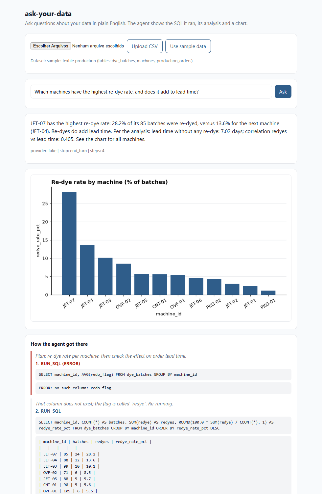
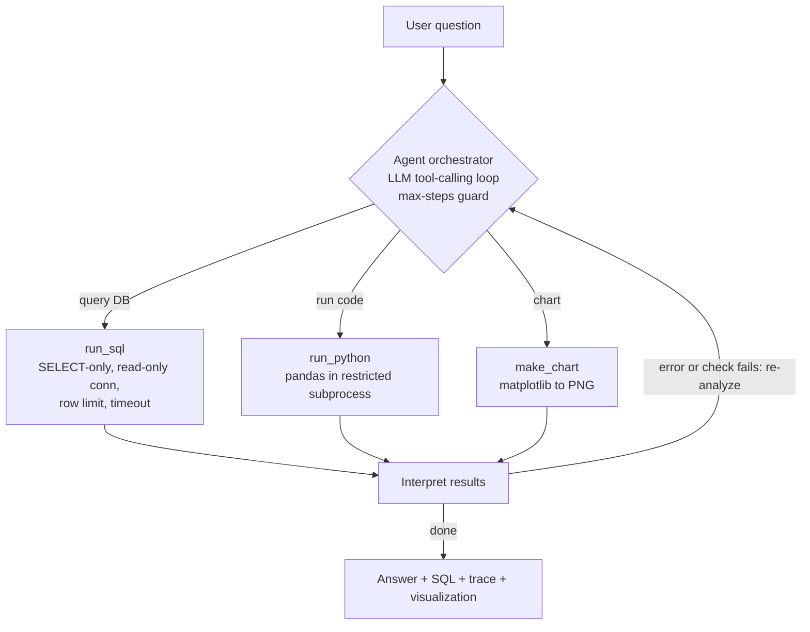

# ask-your-data

**Ask questions about a CSV or SQL database in plain English. An agent answers with the SQL it ran, a pandas check, and a chart.**

[](https://github.com/danbws/ask-your-data/actions/workflows/ci.yml)

> **This is a portfolio project**, not a product. There are no customers and no usage numbers.
> The data in the demo is synthetic (textile dyeing: orders, machines, dye batches), generated by a
> seeded script.
>
> **How I built it:** AI-augmented with Claude Code, then reviewed, run and tested by me
> (Daniel Bichof). The agent loop and the safety layers are the parts I'd like to talk about.



*The screenshot is `--demo` / no-API-key mode: a scripted provider replays fixed tool calls (the
first query is wrong on purpose so you can see the agent recover). With `ANTHROPIC_API_KEY` set,
the same loop is driven by Claude.*

## What it is

- Upload one or more CSVs (each becomes a table), or point at a SQLite / PostgreSQL database.
- Ask a question. An LLM agent decides which **tools** to call:
  - `run_sql` — one read-only `SELECT`
  - `run_python` — pandas analysis on the result of a `SELECT`, in a restricted subprocess
  - `make_chart` — matplotlib PNG from a `SELECT`
- You get the answer, the **full step trace** (every SQL / code / result), and the chart.
- Interfaces: CLI, FastAPI (`POST /datasets`, `POST /ask`) and a one-page web UI.

## Demo (no API key needed)

```bash
python -m venv .venv && source .venv/bin/activate     # Windows: .venv\Scripts\activate
pip install -e ".[dev]"

python -m ask_your_data --demo                         # scripted run on the synthetic data
python -m ask_your_data --serve                        # web UI + API at http://127.0.0.1:8000
```

Click **Use sample data**, then **Ask**. Without a key only the sample dataset can be queried, and
the answer comes from the scripted provider (it ignores the question text — it is a test double,
not a model).

### With a real model

```bash
export ANTHROPIC_API_KEY=sk-ant-...                    # see .env.example
python -m ask_your_data "Which customers have the longest average lead time?" \
    --csv sample_data/production_orders.csv

python -m ask_your_data "Does the re-dye rate differ by machine type?" \
    --csv sample_data/machines.csv --csv sample_data/dye_batches.csv
```

The default model is `claude-sonnet-5-5` (override with `ASK_YOUR_DATA_MODEL`).
**Not verified:** I have not run this against the live API in this repo's test suite — see
[Next steps](#next-steps). The provider is covered by tests against a stubbed SDK client.

### API

| Method | Path | Purpose |
|--------|------|---------|
| POST | `/datasets` | Upload CSV file(s) (multipart `files`, 20 MB each) |
| POST | `/datasets/sample` | Create the synthetic sample dataset |
| POST | `/datasets/connect` | Point at `sqlite:///...` / `postgresql://...` (disabled unless `ASK_YOUR_DATA_ALLOW_DB_URLS=1`) |
| POST | `/ask` | `{dataset_id, question, max_steps}` → answer, `steps` trace, `sql`, `chart_base64` |

## Architecture



```
ask_your_data/
  agent.py              the loop (read this first)
  tools.py              tool schemas + execution
  sql_guard.py          sqlglot-based SELECT-only validation
  db.py                 read-only SQLite / PostgreSQL, CSV ingest
  sandbox.py            run_python subprocess
  charts.py             make_chart
  providers/            Provider protocol, AnthropicProvider, FakeProvider (+ demo script)
  api.py, cli.py, static/index.html
  sample_data.py        seeded synthetic generator
```

The loop in `agent.py`: send the question + schema + tool definitions → if the model asks for
tools, run them, return **all** results of that turn in one message → repeat until the model
answers in plain text or `max_steps` is reached. There is no separate "retry mode": a failed tool
returns `is_error: true` with the message, and the model can fix its query or re-check a number
with a different tool.

## Design decisions and trade-offs

- **Hand-written loop instead of an SDK tool runner or framework.** A few dozen lines, easy to read
  and to put a guard (`max_steps`) and a trace in. A framework would hide exactly the part this
  project is meant to show.
- **Provider abstraction with a deterministic fake.** The agent depends on a one-method protocol.
  Tests, CI and `--demo` use a scripted provider, so the whole loop (tools, error recovery,
  step limit, API) is tested without network or cost. The trade-off: tests prove the *plumbing*,
  not model quality. There is no eval of answer correctness.
- **`run_python` never gets a database handle.** It receives the result of a guarded `SELECT` as
  a DataFrame (`df`). That keeps the DB boundary in one place (`run_sql`'s guard + read-only
  connection) and makes the subprocess database-agnostic (works the same for PostgreSQL).
  The cost: analysis is limited to what one query returns (100,000 rows).
- **`make_chart` takes a spec, not code.** The model picks a chart kind and columns; matplotlib
  does the drawing. Less flexible than letting the model write plotting code, but nothing to
  sandbox and results are consistent.
- **SQLite for CSVs.** CSVs are loaded into a private SQLite file, so SQL works the same for
  uploads and existing databases. Dates stay text (ISO strings sort correctly); there's no type
  inference beyond what pandas does.
- **No forced `tool_choice`, no temperature.** Recent Claude models reject some of these; the
  loop works with the model deciding when to call tools.

## Security notes

Read-only SQL is enforced in two independent layers:

1. **Parse and allow-list** (`sql_guard.py`, sqlglot): exactly one statement, must be a
   `SELECT`/`WITH`/`UNION` query; any `INSERT/UPDATE/DELETE/DROP/CREATE/ALTER/PRAGMA/ATTACH/...`
   node anywhere in the tree is rejected, as are a few dangerous functions
   (`load_extension`, `pg_sleep`, `pg_read_file`, ...).
2. **The connection itself**: SQLite is opened `mode=ro` with `query_only` and an authorizer that
   only allows reads; PostgreSQL sessions are `default_transaction_read_only` with a statement
   timeout. A guard bug should not become a write.

Also: row limit on every query, 5 s query timeout, 10 s Python timeout.

**`run_python` is not a hardened sandbox.** It is a separate `python -I` process with a reduced
environment, a temp working directory, a timeout, truncated output, and an audit hook that blocks
sockets, subprocesses and writes outside the temp dir. Audit hooks can be bypassed by determined
code, and there is no memory/CPU limit on Windows. It is fine for a local demo with a model you
trust; **do not expose it to untrusted users** without running it in a container or VM.

Other things to know:
- The prompt contains the schema and 3 sample rows per table, and tool results go back to the
  model. Don't point it at a database whose contents you may not send to an LLM provider.
- `/datasets/connect` is off by default because a `sqlite:///` URL reads local files; enable it
  only on a trusted, local deployment.
- The API has no authentication and datasets live in a temp directory. It's a demo server.
- The PostgreSQL path is implemented but **not covered by automated tests** (CI has no database
  service) and I have not run it against a real server.

## Tests

```bash
pip install -e ".[dev]"
ruff check .
pytest -v
```

Covered: SQL guard (writes/DDL/multi-statement/functions rejected, read-only connection, row
limit, timeout), Python runner (timeout, output cap, blocked network/subprocess/writes), the
agent loop end to end with the fake provider (error recovery, max-steps guard, tool results
batching), the Anthropic provider against a stubbed client (request shape, error mapping), API
endpoints, CSV ingest, deterministic sample data and chart rendering. CI runs ruff, pytest and
`--demo` on every push.

## Next steps

- Run an end-to-end check against the live API and add an opt-in test (skipped without a key).
- A small eval set: questions with known answers on the synthetic data, to measure the model
  instead of only the plumbing.
- Enable the server-side refusal fallback for Claude (a `refusal` stop reason is currently shown
  as the final answer, not retried).
- Real sandbox for `run_python` (container, resource limits), and auth on the API.
- Stream the trace to the UI as steps happen; support follow-up questions in a conversation.

## License

MIT
